# Tosakana – Kinshasa Streets

**Made by Joel Kalala** · Unity 2022.3

*"Tosakana" means "let's play" in Lingala.*

An open-city game set in a small Kinshasa. Walk the streets, take any car, and do delivery jobs across the city
before time runs out. Every job pays money.

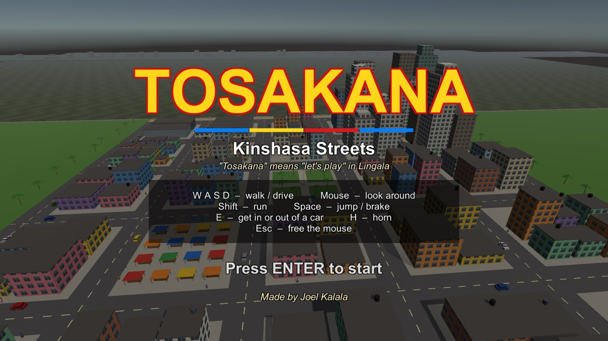

| | |
|---|---|
|  |  |
|  |  |
| 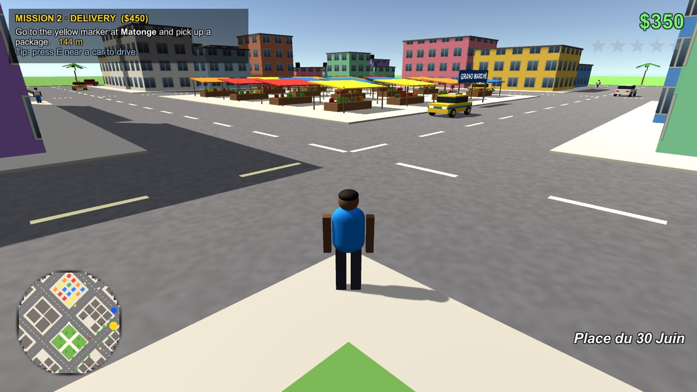 | 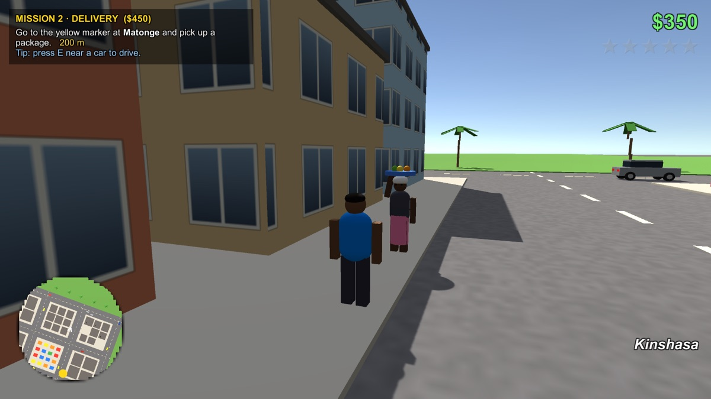 |
|  | 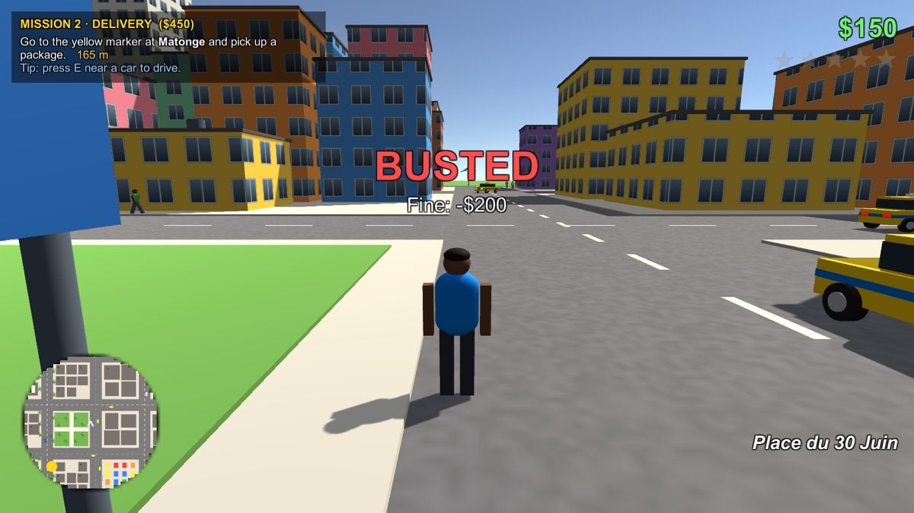 |
| 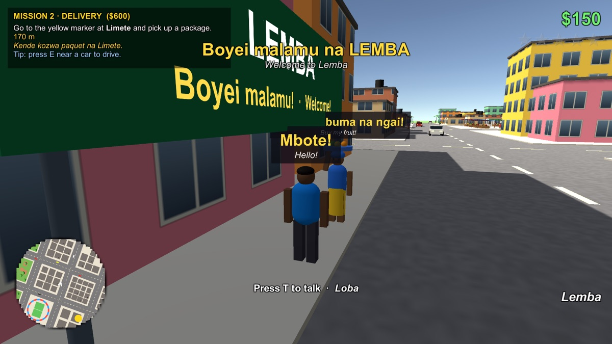 | 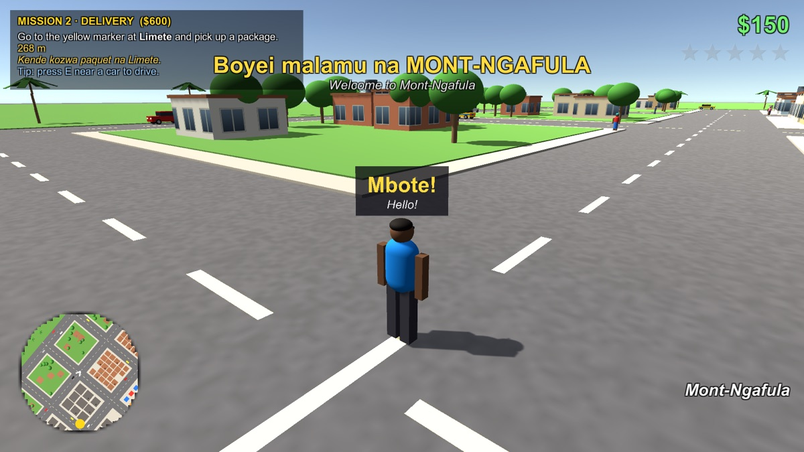 |
| 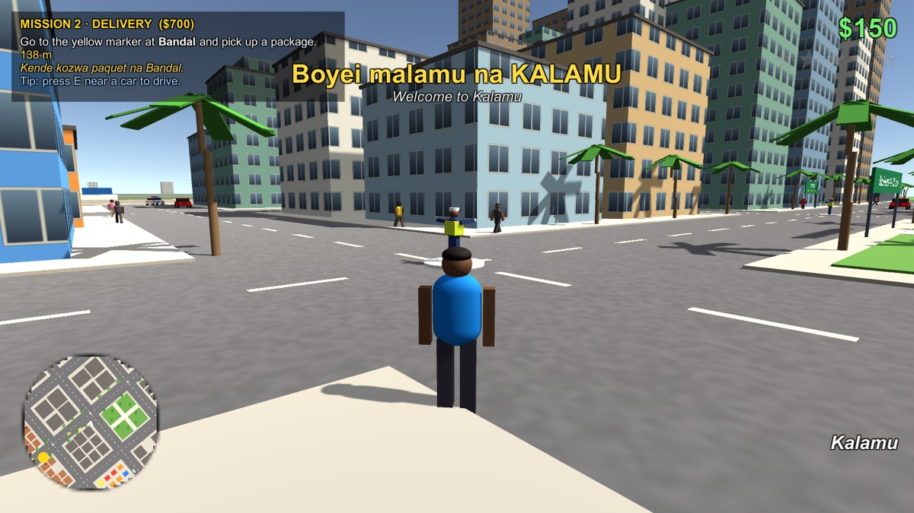 | 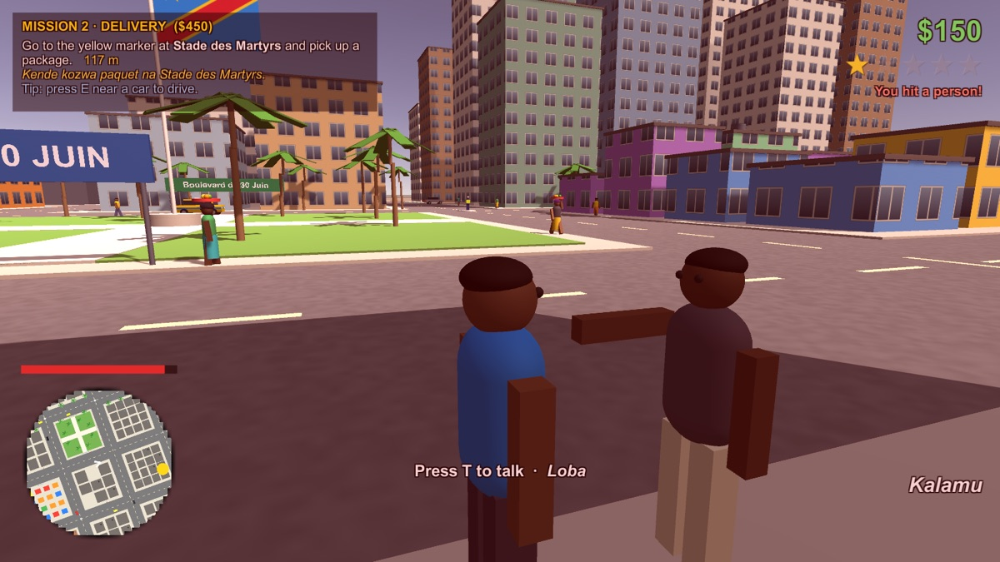 |
| 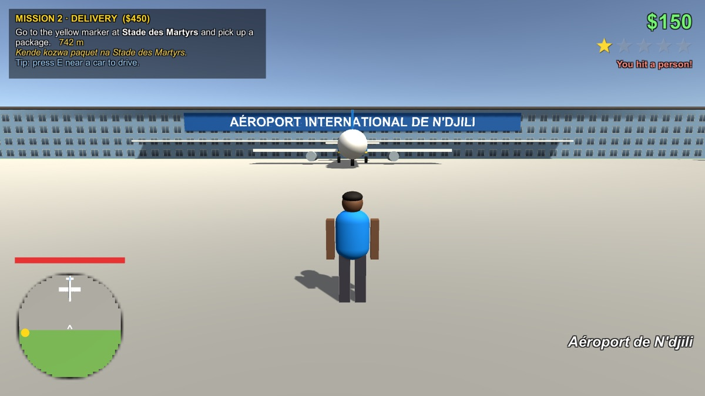 | 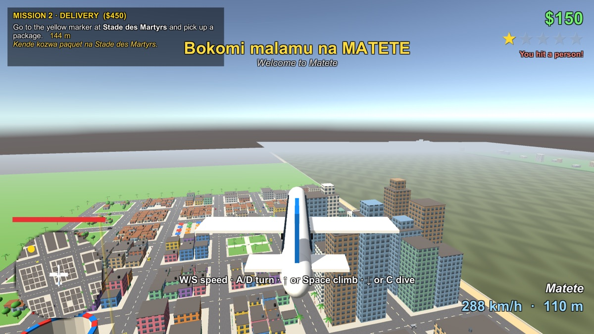 |
| 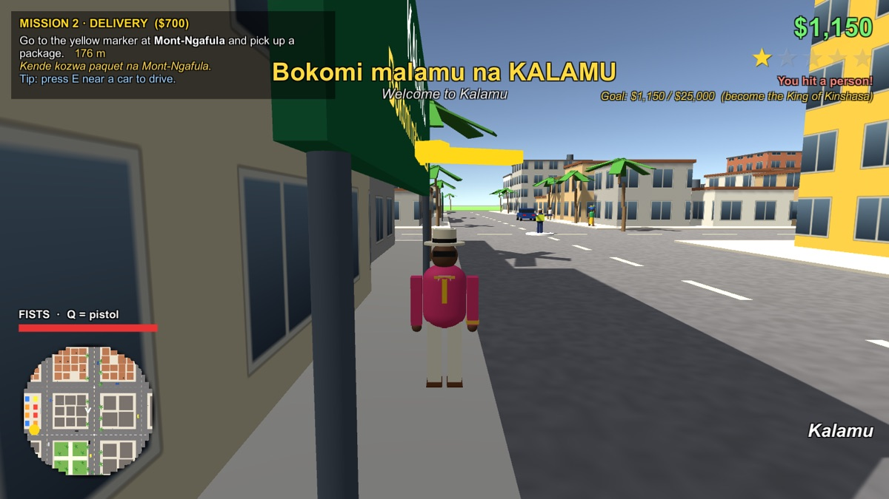 | 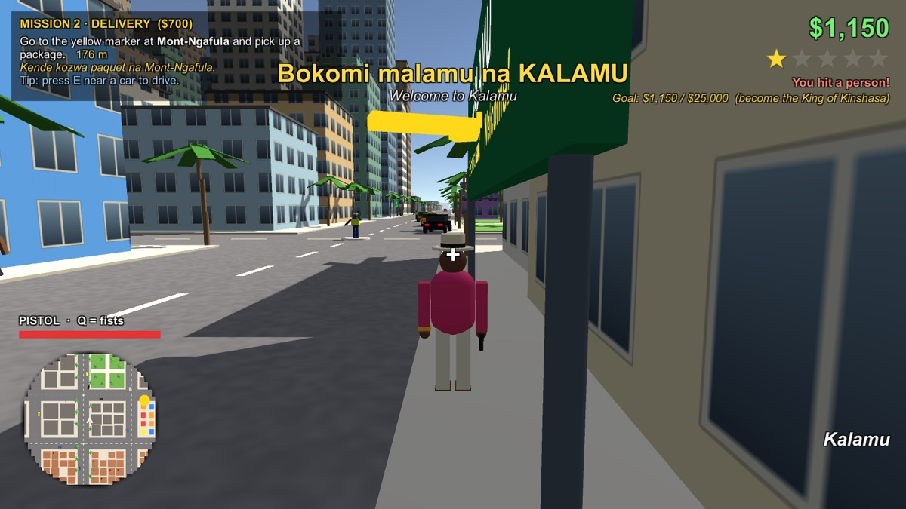 |
| 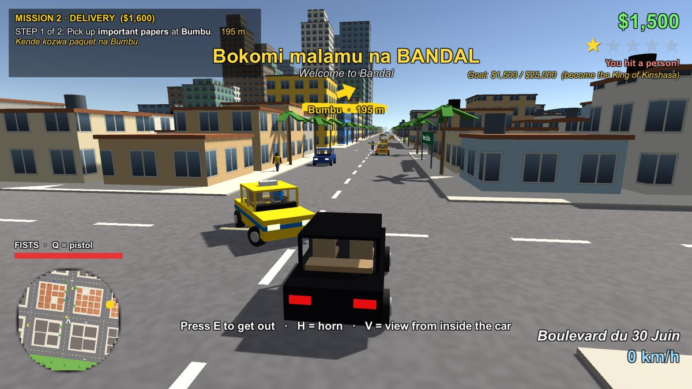 | 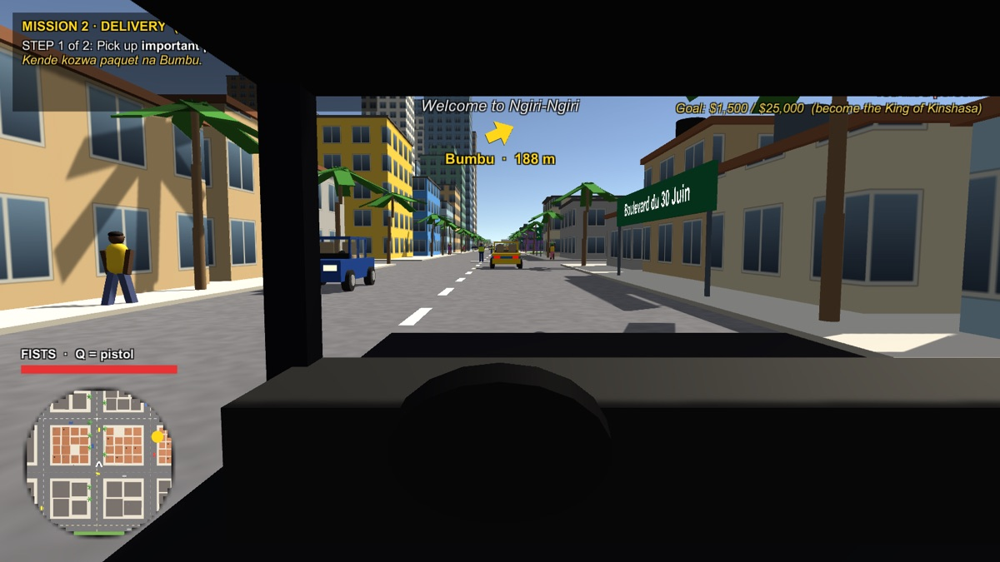 |
| 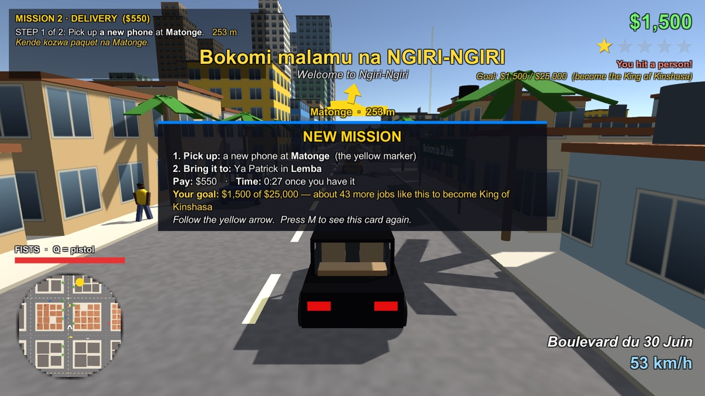 | |

## Places in the city
- **Place du 30 Juin** – the square with the DRC flag (you start here)
- **Boulevard du 30 Juin** – the big street with palm trees
- **Grand Marché** – the market
- **Gombe** – the tall towers
- **Matonge** – colorful houses
- **Stade des Martyrs** – the stadium
- **Port de Ngobila** – on the Fleuve Congo

## Controls
| Key | What it does |
|---|---|
| W A S D | walk / drive |
| Mouse | look around |
| Shift | run |
| Space | jump / brake |
| E | get in or out of a car |
| H | horn |
| T | talk to someone (in Lingala) |
| Left click / R | punch (click fast for a combo: jab, cross, hook) — or shoot with the pistol |
| G | kick |
| Right click / B (hold) | block |
| X | dodge to the side |
| Q | fists / pistol |
| V | view from inside the car / from behind |
| N | next radio station (in a car) |
| O | change clothes: sapeur suit / street look |
| Tab | big map (click = waypoint, right click = remove, wheel = zoom) |
| M | show the mission card again |
| In a plane | W/S speed · A/D turn · ↑ or Space climb · ↓ or C dive |
| Esc | free the mouse (click to take it back) |

## Version 1 has
- Walking and running with a third-person camera
- Cars you can get into and drive (yellow-and-blue taxis too)
- Delivery missions with a timer, money, MISSION PASSED / MISSION FAILED
- A round mini-map that turns with you and shows where to go
- Area names (Gombe, Matonge, ...) at the bottom right
- Sounds: engine, horn, doors, crashes, mission music

## Version 2 adds
- **Traffic:** 18 cars (many yellow-and-blue taxis) drive on the right side of the road, turn at crossroads,
  stop for people and cars in front of them, and honk if you block the road
- **Take any car:** press E next to a traffic car, and the driver gets out and walks away
- **People:** about 45 people walk on the sidewalks. Some wear a pagne and head wrap, and some carry a basin of fruit on their head
- People cross the streets, jump out of the way of fast cars, and if you hit them they fall down and get back up

## Version 3 adds: police and wanted stars ⭐
- **Crimes give you stars (up to 5):** hitting a person with your car, taking a car while the police can see you,
  stealing a police car (+2), or ramming a police car
- **2 police cars patrol the city.** When you are wanted, they turn on red and blue lights and a siren and chase you
  through the streets. More stars bring more police cars.
- **BUSTED:** if the police catch you while you are stopped, you pay a $200 fine, lose your stars, and start again at Place du 30 Juin
- **Escape:** after the police find you, get far away from all of them. The stars blink while they search,
  then you see "YOU LOST THE POLICE"
- Police cars show as red and blue dots on the mini-map

## Version 4 adds: Kinshasa communes and Lingala 🇨🇩
- **A bigger city with 12 communes**, roughly where they really are:
  Gombe, Kintambo and Limete by the river; Lingwala, Ngiri-Ngiri, Bandal, Kalamu, Matonge in the middle;
  Bumbu, Selembao and Lemba further south; Mont-Ngafula with green land and mango trees
- Each commune has its own look (Gombe towers, Bumbu and Selembao small houses with tin roofs, bright Matonge, Limete warehouses)
- Each commune has a sign and a mission place. When you enter one: **"Bokomi malamu na LEMBA"** (Welcome to Lemba)
- **People speak Lingala** in speech bubbles, with the English under each line:
  - Press **T** near someone to talk: *"Mbote!"* → *"Mbote na yo, ndeko!"*
  - People say *"Keba!"* when a car comes, *"Moyibi!"* when you take a car, and *"Ozali liboma?"* if you hit them
  - Drivers shout *"Pesa nzela!"* and the police shout *"Kanga ye!"*
- Missions and big messages have Lingala too (*"Kende kozwa paquet na Gombe"*, *"Matondo!"*, *"Bakangi yo!"*)
- All the Lingala is in one file, `Assets/Scripts/Lingala.cs`, so it is easy to fix or add lines

## Version 5 adds: real voices and roulage 🎙️👮🏾
- **People speak out loud, no text bubbles.** Every Lingala line is spoken with Joel's own recorded voice
  (each person gets a slightly different pitch, so one voice becomes many people)
- **Voice recorder inside Unity:** Tools → Tosakana → Record Voices. 57 lines, with ● Record, ■ Stop and ▶ Listen.
  Lines not recorded yet play a soft murmur that follows the vowels of the words
- **End of a mission:** the customer thanks you and blesses you: *"Matondo mingi! Nzambe apambola yo!"*
- **Roulage officers** stand in the middle of 5 busy crossroads. They whistle, wave, and the traffic stops and goes when they say.
  They shout *"Leka! Leka!"* and *"Telema kuna!"* Hit one and you get 2 wanted stars

## Version 6 adds: fights, a bigger Kinshasa and N'djili airport 🥊
- **Punch** with left click or R. People fall, then run away (*"Bosalisa ngai!"*) or fight back (*"Yaka! Tobunda!"*)
- A **health bar**; if it runs out you are KNOCKED OUT (*"Babeti yo!"*)
- Wanted on foot: **police officers get out of their cars** and run at you (*"Maboko likolo!"*). Three punches knock one down
- The city grows east: **Matete, Masina, N'djili, Kimbanseke, Kingasani** and **Boulevard Lumumba** (17 communes, 845 buildings)
- **Aéroport International de N'djili**: runway, terminal, control tower, planes, and a plane that takes off again and again

## Version 7 adds: fly the planes ✈️
- Press **E** next to a plane at the terminal to get in
- W/S speed, A/D turn, ↑ or Space climb (when fast enough), ↓ or C dive; speed and height on the screen
- Hit a building or the ground too hard: **CRASHED** (*"Avion ekwei!"*)

## Version 8 adds: a rich man with a goal 🕴🏾🎯
- **The goal:** you start with $1,000. Earn **$25,000** to become **"Mokonzi ya Kinshasa"** (King of Kinshasa). Your progress is on the screen
- **A yellow arrow** floats over your head (or your car or plane) and points to your mission
- You are a **Kinshasa sapeur**: bright suit, white trousers, hat, sunglasses, tie, gold chain and gold watch. Your own car is a shiny black luxury car
- **Easier landing:** near the ground the plane levels out by itself, so you can land softly

## Version 9 adds: the pistol 🔫
- **Q** switches between your fists and a pistol; **left click** shoots where the + points
- People you shoot fall and don't get up; gunshots make everyone near run away
- Shooting brings wanted stars (shooting a police officer: +2)

## Version 10 adds: sit in the car, see where to go, know your mission 🚗🧭
- Cars have **see-through windows**, seats, a dashboard and a steering wheel. **You sit at the wheel** in your sapeur suit, and city drivers sit in their cars (when you take a car, its driver gets out)
- **V** = view from **inside the car**, looking out the front window
- A **direction arrow** at the top of the screen always points to your mission, with the place and the distance
- Every mission starts with a **mission card**: what to pick up (fufu, medicine, a wedding cake...), for whom, where to bring it, the pay, and how many more jobs until you are King of Kinshasa. **M** shows it again
- The mission box says **STEP 1 of 2** (pick up) and **STEP 2 of 2** (deliver); missions pay more (about 20 jobs to reach $25,000)

## Version 11 adds: day and night, the car radio, flags and new clothes 🌇📻🇨🇩
- **Day and night**: the sun moves across the sky (one day = 12 minutes). Sunset turns the sky orange; at night the windows glow, **street lamps** shine on the boulevard, and your car turns on its **headlights**. A clock shows the time
- **Car radio**: it plays when you get in a car. **N** = next station. *Tosakana FM* plays rumba (sebene guitar, bass, drums) that the game makes itself
- **Your own music**: put MP3 songs you own (for example Fally Ipupa, Koffi Olomide, JB Mpiana) in `Assets/Resources/Radio/Rumba`, `Ndombolo` or `Mix`. They become the stations *Kin Rumba FM*, *Ndombolo Radio* and *Mboka Mix*. This folder is **not** put on GitHub, because the songs belong to the artists
- **Spotify station** (Mac, with the Spotify app installed): when you pick *Spotify* with **N**, the game tells your own Spotify app to play, and pauses it when you get out of the car. The song name shows on the radio. The first time, macOS asks "Unity wants to control Spotify": click **OK**
- **DRC flags** wave in the wind at every commune, the airport, the stadium, the port and Place du 30 Juin
- **O** = change clothes: the sapeur suit, or the **street look** (Leopards jersey, jeans, white sneakers, red cap). You wear the same clothes when you sit in the car

## Version 12 adds: real bodies, real fights, kuluna and the ring 🥊
- **New bodies for everyone**: knees, elbows, shoulders, a spine and a head that move. People walk with bending knees and swinging arms
- **Real faces**: eyes, eyebrows, nose, lips, ears, hair, and a short beard for you (and some men in the street)
- **Better fighting**: click fast for a combo (**jab, cross, hook**), **G** = kick, hold **right click / B** to block, **X** to dodge. People have health now: a health bar shows who you fight. Watch for them pulling their fist back, then block or dodge!
- **Street fights**: sometimes two people near you start fighting each other and others stop to watch. Join in if you want
- **Kuluna** (street gangs) wait at a corner in Matete, Kimbanseke and Selembao (red dots on the map). Get close and all three attack you. Beat them all: **+$300** (no police stars: it's self-defense). They come back later
- **Ring ya Kin** at Place du 30 Juin (red dot on the map): walk into the ring to fight for money. 5 fighters, from Bokilo ($400) to Nkoy ya Kin ($1,500). Each win brings a stronger fighter

## Version 13 adds: steal cars, fights that grow, the big map and GPS 🗺️🚗
- **Carjacking**: press E next to a car with a driver and you pull them out. They fall on the road, shout, then run away... or run after you. Stop the car next to them and they **pull you out** and fight you
- **Fights grow**: more people hit back when you punch them, and a friend standing close may join the fight
- **Big map (Tab)**: all of Kinshasa from the sky with the names of the communes and places, and icons for you, your mission, the ring, the kuluna, the airport and the police. The game stops while it is open
- **Waypoint**: click on the big map to put a purple waypoint. It shows on the mini-map, and the arrow takes you there when you have no mission
- **GPS**: a line on the roads of the mini-map shows the way: yellow to your mission, purple to your waypoint

## How to open
Open the folder in Unity Hub (Unity 2022.3). The game is in `Assets/Scenes/Main.unity`. Press ▶ Play.
To rebuild the city: **Tools → Tosakana → Build City**.

## Credits
Game design: Joel Kalala. Built with help from Claude (AI assistant).
