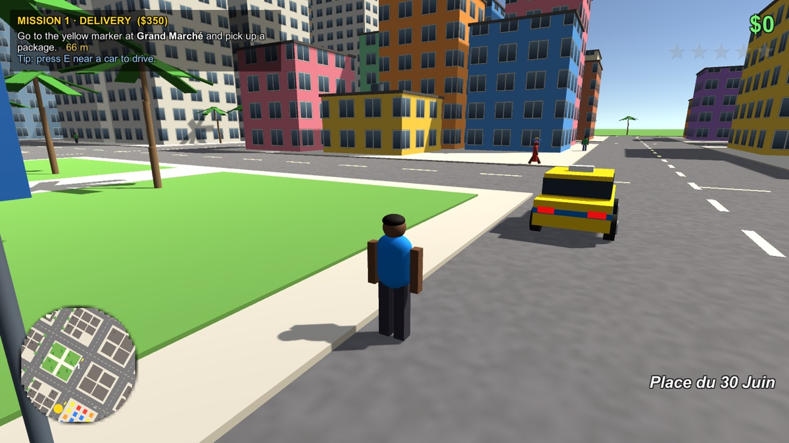
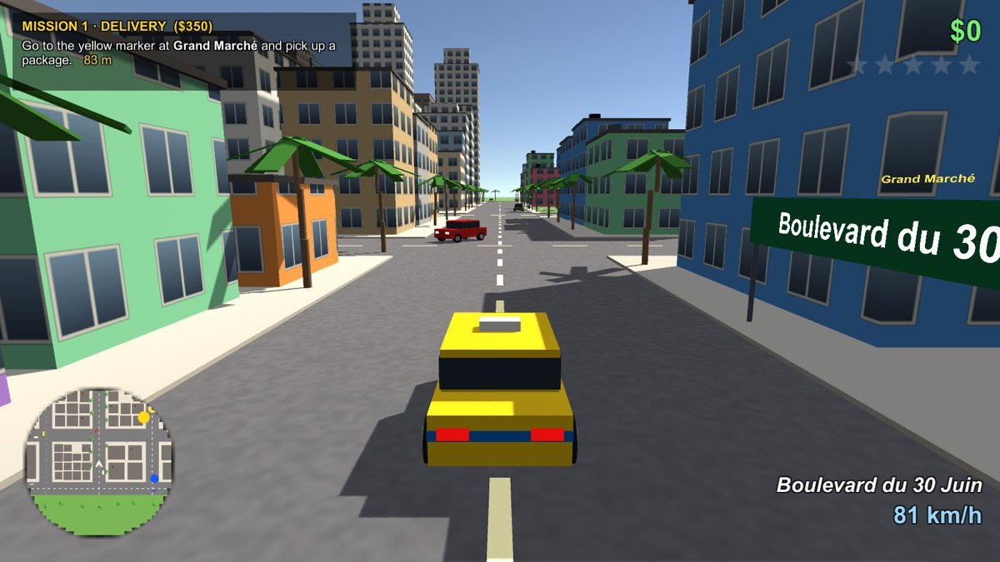
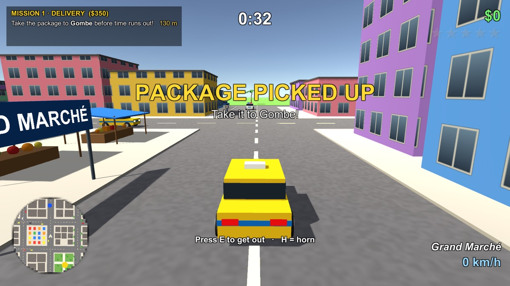
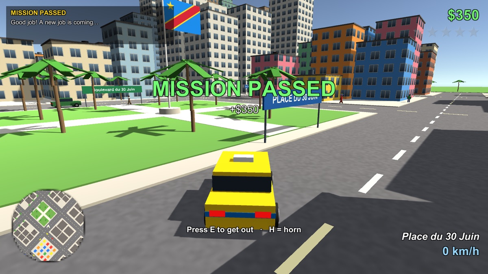
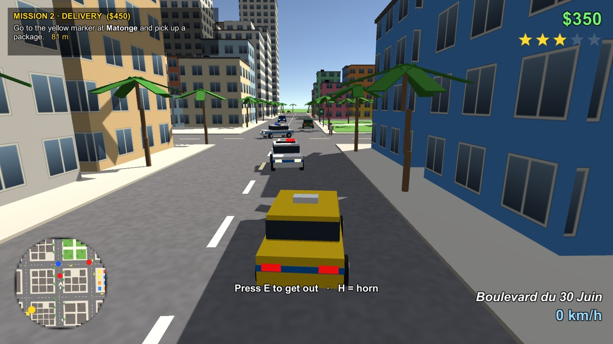

# Tosakana – Kinshasa Streets

**Made by Joel Kalala** · Unity 2022.3

*"Tosakana" means "let's play" in Lingala.*

An open-city game set in a small Kinshasa. Walk the streets, take any car, and do delivery jobs across the city
before time runs out. Every job pays money.

| | |
|---|---|
|  |  |
|  |  |
|  |  |
|  |  |

## Places in the city
- **Place du 30 Juin** – the square with the DRC flag (you start here)
- **Boulevard du 30 Juin** – the big street with palm trees
- **Grand Marché** – the market
- **Gombe** – the tall towers
- **Matonge** – colorful houses
- **Stade des Martyrs** – the stadium
- **Port de Ngobila** – on the Fleuve Congo

## Controls
| Key | What it does |
|---|---|
| W A S D | walk / drive |
| Mouse | look around |
| Shift | run |
| Space | jump / brake |
| E | get in or out of a car |
| H | horn |
| Esc | free the mouse (click to take it back) |

## Version 1 has
- Walking and running with a third-person camera
- Cars you can get into and drive (yellow-and-blue taxis too)
- Delivery missions with a timer, money, MISSION PASSED / MISSION FAILED
- A round mini-map that turns with you and shows where to go
- Area names (Gombe, Matonge, ...) at the bottom right
- Sounds: engine, horn, doors, crashes, mission music

## Version 2 adds
- **Traffic:** 18 cars (many yellow-and-blue taxis) drive on the right side of the road, turn at crossroads,
  stop for people and cars in front of them, and honk if you block the road
- **Take any car:** press E next to a traffic car, and the driver gets out and walks away
- **People:** about 45 people walk on the sidewalks. Some wear a pagne and head wrap, and some carry a basin of fruit on their head
- People cross the streets, jump out of the way of fast cars, and if you hit them they fall down and get back up

## Version 3 adds: police and wanted stars ⭐
- **Crimes give you stars (up to 5):** hitting a person with your car, taking a car while the police can see you,
  stealing a police car (+2), or ramming a police car
- **2 police cars patrol the city.** When you are wanted, they turn on red and blue lights and a siren and chase you
  through the streets. More stars bring more police cars.
- **BUSTED:** if the police catch you while you are stopped, you pay a $200 fine, lose your stars, and start again at Place du 30 Juin
- **Escape:** after the police find you, get far away from all of them. The stars blink while they search,
  then you see "YOU LOST THE POLICE"
- Police cars show as red and blue dots on the mini-map

## How to open
Open the folder in Unity Hub (Unity 2022.3). The game is in `Assets/Scenes/Main.unity`. Press ▶ Play.
To rebuild the city: **Tools → Tosakana → Build City**.

## Credits
Game design: Joel Kalala. Built with help from Claude (AI assistant).
